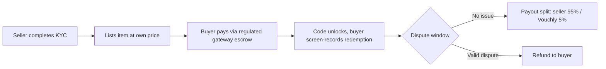

<div align="center">

# Vouchly

### A compliance-first marketplace for unused gift cards, coupons, subscription vouchers and group plans in India


[Overview](#overview) · [Features](#features) · [Compliance](#compliance-design) · [Quick start](#quick-start) · [Configuration](#configuration) · [Roadmap](#roadmap) · [Contact](#contact)

</div>

---

> [!WARNING]
> **This is a beta prototype.** Payments, KYC, penny-drop checks and payouts are **simulated**. Data is stored only in the browser (`localStorage`). Do not use real vouchers, real PAN numbers or real bank details until the production backend and legal review are complete.

> [!NOTE]
> Vouchly is **not legal, tax or financial advice**. Nothing in this repository is a legal opinion. Have a lawyer and a Chartered Accountant review the full flow before launch.

## Table of contents

- [Overview](#overview)
- [Why Vouchly](#why-vouchly)
- [Features](#features)
- [How it works](#how-it-works)
- [Compliance design](#compliance-design)
- [Tech stack](#tech-stack)
- [Quick start](#quick-start)
- [Configuration](#configuration)
- [Project structure](#project-structure)
- [Data and privacy in the beta](#data-and-privacy-in-the-beta)
- [Roadmap](#roadmap)
- [Known limitations](#known-limitations)
- [Contributing](#contributing)
- [License](#license)
- [Disclaimer](#disclaimer)
- [Contact](#contact)

## Overview

Vouchly is a marketplace concept where people in India can sell unused **gift cards**, **single-use coupons** and **transferable subscription vouchers**, and split **official multi-seat group plans**. The code stays **locked until the buyer pays**, and the design is built around trust, KYC and a regulated payment flow.

The current repository is a **single-file front-end prototype** (`index.html`) used to validate the idea and to show the intended user experience and safeguards.

## Why Vouchly

Every year, many vouchers, cashback coupons and scratch-card offers expire unused. Today, people trade them informally in chat groups and social threads, with no payment protection, no verification and frequent fraud.

Vouchly aims to replace that with:

- A transparent listing and pay-to-unlock flow
- Verified sellers
- Dispute handling with proof
- A structure designed around Indian rules for intermediaries, payments, tax and data protection

## Features

### Marketplace

- Category filters, search and sorting (newest, price, biggest discount)
- Listing cards with image carousel, expiry, details and a report link
- Code hidden until payment is confirmed
- Beta category scope: **Gift cards, Coupons, Subscription vouchers** (plus Shopping, Food, Fashion, Entertainment, Travel, Other as display tags)
- Referral codes, software keys and digital products are **disabled** in this phase

### Seller tools

- Sell form with legal name, PAN (format check), state and UPI ID
- **Auto-fill from pasted offer text** (GPay / PhonePe style messages) using regex extraction of value, discount, brand, code and expiry
- Per-listing price cap of **INR 5,000** (beta)
- Automatic blocking of restricted keywords (ad credits, account logins, shared accounts, household-only family plans)
- Four seller declarations (ownership, transferability, age and tax, KYC consent)
- Net payout preview after the 5% fee

### Group plans

- Split an official team or business plan across seats
- Per-seat price calculation
- Host KYC (legal name, PAN, state, UPI) and payout disclosure
- Staged (monthly) release concept for yearly plans
- Household-only providers are blocked by design

### Buyer protection

- Pay-to-unlock checkout with terms and refund acceptance
- 48-hour dispute window (beta) and screen-recording guidance
- Receipt concept showing the seller's legal name and state
- Purchase history with dispute window and a report action

### Want to buy board

- Buyers post a request and a maximum price
- Explicit consent for alerts (email), with marketing off by default

### Account menu (right-side drawer)

- Profile and KYC
- Bank and UPI accounts (UPI ID or bank details with IFSC validation; only the last 4 digits of an account number are stored)
- My listings and My purchases
- Payouts and tax (hold tiers, fee summary and the INR 5 lakh TDS threshold tracker)
- Notifications
- Privacy and data (download or erase your data)

### Design and accessibility

- **Light, Dark and System themes** with no flash on load
- Material-inspired UI, ripple effects and reduced-motion support
- Keyboard focus styles, ARIA labels and `dialog`-based modals
- Mobile-first and responsive layout

## How it works



1. **List:** the seller adds the item, price and payout account. The code is never shown publicly.
2. **Pay:** the buyer pays. In production, an RBI-authorised payment aggregator holds the funds, not Vouchly.
3. **Unlock and verify:** the buyer receives the code and records the redemption as proof.
4. **Release or refund:** after the dispute window, funds are split to the seller and the platform fee, or refunded on a valid dispute.

## Compliance design

The product is designed around the following areas. This table describes **design intent**, not certification.

| Area | Design approach |
| --- | --- |
| Intermediary status | Marketplace model under the IT Act, 2000 (Section 79) and the IT Rules, 2021, with a named Grievance Officer |
| E-commerce rules | Seller legal name and state shown on the receipt, clear pricing and a complaint process (Consumer Protection (E-Commerce) Rules, 2020) |
| Payments | Regulated payment aggregator with nodal escrow and split settlement. Vouchly does not hold buyer funds in its own account |
| Tax | E-commerce TDS under Section 393(1) of the Income-tax Act, 2025 (0.1%, with an exemption for individuals up to INR 5 lakh a year with PAN or Aadhaar on file) and GST TCS handling as applicable. Confirm all tax treatment with a CA |
| Data protection | DPDP Act, 2023 and Rules, 2025: notice, consent, minimisation, erasure and a grievance route. Core notice and consent duties are scheduled from **13 May 2027** |
| Security and logs | CERT-In incident reporting and log retention to be implemented in production |
| Brand terms | Many issuers restrict transfer for value. Sellers must confirm transferability, and brands can request takedowns |
| Platform policies | Google Ads credits and similar items are blocked. Household-only family plans are blocked. Brand logos should only be used with permission |
| AML | KYC, listing caps and suspicious-activity handling to be defined with counsel |

### Prohibited in this beta

- Stolen, expired, redeemed or duplicate codes
- Account logins, passwords or shared accounts
- Advertising credits (for example, Google Ads promotional credits)
- Family-plan seats for providers that limit them to one household
- Cracked or restricted licence keys
- Anything illegal or against the issuer's terms

## Tech stack

| Layer | Technology |
| --- | --- |
| Markup and styling | HTML5, CSS custom properties (design tokens), CSS Grid and Flexbox |
| Logic | Vanilla JavaScript (ES5-compatible style), no framework |
| Storage (beta) | Browser `localStorage` |
| Fonts | Google Sans and Roboto via Google Fonts, with system fallbacks |
| Build | None. Open the file in a browser |

## Quick start

### Option 1: open the file

```bash
git clone https://github.com/<your-username>/vouchly.git
cd vouchly
# open index.html in your browser
```

### Option 2: run a local server

```bash
# Python 3
python3 -m http.server 8000
# then visit http://localhost:8000
```

```bash
# Node.js
npx serve .
```

### Option 3: deploy as a static site

Host `index.html` on any static host (GitHub Pages, Netlify, Cloudflare Pages, Firebase Hosting or Vercel). No build step is required.

## Configuration

Business details are kept in one object near the top of the script inside `index.html`:

```js
CFG = {
  name:    "[Your registered business name]",
  addr:    "[Registered office address, City, State, PIN]",
  email:   "support@yourdomain.com",
  officer: "[Grievance Officer full name]",
  oemail:  "grievance@yourdomain.com",
  city:    "[City]"
}
```

Other values you may want to adjust:

| Setting | What it controls | Default |
| --- | --- | --- |
| `CAP` | Maximum listing price (INR) | `5000` |
| `HID` | Categories hidden in the current phase | Referral codes, Software and keys, Digital products |
| `BLOCK` | Regex for blocked keywords in listings and requests | Ad credits, logins, shared accounts and similar |
| `HOUSE` | Regex for household-only providers blocked in group plans | Common family-plan providers |
| Platform fee | Fee shown in checkout and payout preview | `5%` |
| Dispute window | Hold period text in checkout and purchases | `48 hours` |

Before publishing, also replace the placeholder values in the `<head>` (`canonical`, Open Graph and JSON-LD URLs that point to `example.com`).

## Project structure

```text
vouchly/
├── index.html    # Entire app: markup, styles, scripts, legal pages
└── README.md     # This file
```

Inside `index.html`:

- **Head:** meta tags, early theme script (prevents theme flash), design tokens and styles
- **Body:** header, hero, marketplace, group plans, trust section, want-to-buy board, FAQ, footer
- **Dialogs:** item details and checkout, sell form, group form, want-to-buy form, account views, legal pages
- **Script:** state, rendering, validation, theme, account drawer and legal content (`LG`)

## Data and privacy in the beta

- Everything is stored in your browser. There is no server.
- Keys used: `vouchly_beta_v2` (listings, groups, purchases, requests), `vouchly_profile` (profile, payout accounts, preferences), `vouchly_theme` and `vouchly_ck` (cookie notice).
- Full bank account numbers are **never stored**. Only the last 4 digits are kept.
- The account menu lets you **download** or **erase** this data.
- No analytics, advertising or tracking cookies are used.

## Roadmap

- [x] Single-file prototype with marketplace, groups and legal pages
- [x] Phase 1 scope lock (gift cards, coupons, subscription vouchers, group plans)
- [x] Seller and host KYC fields and validation
- [x] Light, dark and system themes
- [x] Account drawer: profile, payout accounts, listings, purchases, payouts, notifications, privacy
- [x] Want-to-buy board
- [ ] Policy clarification with Google (Pay, Ads, Play) and platform partners
- [ ] Brand allowlist: only issuers whose terms permit transfer
- [ ] Company registration (Private Limited or LLP) and CA and legal review
- [ ] Backend and database (users, listings, orders, disputes, payouts)
- [ ] Payment aggregator integration with split settlement and webhooks
- [ ] Escrow state machine: listed, paid, unlocked, dispute window, released or refunded
- [ ] PAN verification and bank or UPI penny-drop
- [ ] Mobile OTP sign-in
- [ ] Screen-recording dispute flow and moderation tools
- [ ] Monthly staged payouts for yearly group plans
- [ ] AI-assisted offer parser for scratch cards
- [ ] Seller badges (verified corporate or student email)
- [ ] CERT-In logging, DPDP consent records and breach process

## Known limitations

- Payments, KYC, penny-drop and notifications are **simulated**
- Listings and profiles live only in one browser and one device
- Seed listings are demo data. Brand names there are for illustration only
- Tax, GST registration and gateway eligibility are not resolved in code
- The auto-fill parser is regex-based and can miss fields, so users must check every value
- No server-side validation or fraud detection yet

## Contributing

This is currently a personal beta project. Suggestions and bug reports are welcome.

1. Fork the repository
2. Create a branch: `git checkout -b feature/your-change`
3. Keep the single-file, dependency-free approach unless discussed
4. Test in light and dark themes and on a mobile viewport
5. Open a pull request describing what changed and why

Please do not submit real vouchers, personal data or credentials in issues or pull requests.

## License

Copyright (c) Piyush Deshkar. **All rights reserved.**

No licence is granted to copy, modify or redistribute this code without written permission. If you would like to use or collaborate on it, please get in touch.

## Disclaimer

- Vouchly is independent and is **not affiliated with, endorsed by or sponsored by** Google LLC, Google Pay or any brand mentioned.
- All trademarks, logos and brand names belong to their owners and are used only to identify user-listed offers.
- Vouchly does not issue, load or redeem vouchers and does not guarantee their validity or balance.
- Many issuers restrict transfer or resale for value. Sellers are responsible for checking the issuer's terms.
- Laws, regulations and platform policies change. Verify current requirements with qualified professionals before launch.

## Contact

**Piyush Deshkar**
Full Stack Developer | Computer Engineering Student
Wardha, Maharashtra, India

[](mailto:your-email@example.com)
[](https://github.com/your-username)
[](https://www.linkedin.com/in/your-profile)

If you are interested in this idea, feel free to connect.

<div align="center">

Made in India

</div>
